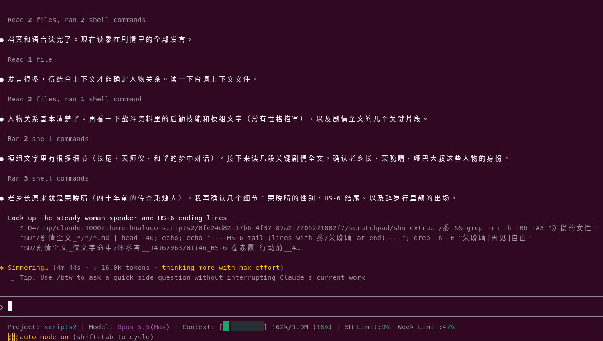

<div align="center">

# 明日方舟 · 干员角色卡

为 [qq-bridge](https://github.com/Derpyu520/qq-bridge) 编写的明日方舟干员角色卡（roles）

[](https://github.com/Derpyu520/qq-bridge)


</div>

> 博士，干员们已经在群里等你了。

把角色卡放进 qq-bridge 的 `roles/` 目录，QQ 群里的 AI 就会以对应干员的身份和大家聊天。每位干员都提供**精简版**和**完整版**两份角色卡，按需选用。

## 关于角色卡

- **人设来源**：干员的性格、爱好、特点等人物设定，均由 AI 分析《明日方舟》剧情得到。
- **外貌认知**：结合干员立绘图片分析外貌特征，让角色了解自己的发色、服饰等细节，描述自身形象时更贴合原作。
- **制作工具**：使用 Claude Code 辅助阅读剧情与干员资料，梳理人物设定、记忆和人物关系，并编写精简版与完整版角色卡。
- **分析模型**：Anthropic Claude Opus 5.5，推理强度 max。
- **记忆范围**：干员的记忆目前仅限《明日方舟》游戏内的内容，**暂不包含**约 500 年后发生在塔卫二的《明日方舟：终末地》（如再旅者等）。

AI 的理解难免有偏差或遗漏，与官方设定冲突时请以游戏为准。觉得哪位干员 OOC 了，欢迎[反馈](#交流与反馈)。

## 精简版与完整版

本仓库为每位干员同时提供两份角色卡：

| 版本 | 篇幅 | 包含内容 | 使用要求 |
| --- | --- | --- | --- |
| **精简版** | 8000 字符以内 | 性格、爱好、特点等人物设定 | qq-bridge 默认设置即可使用 |
| **完整版** | 约 16000 字符 | 在精简版基础上，额外加入干员记忆、人物关系等 | 需要调高注入上限，见[使用方法](#使用方法) |

不确定选哪个时，可以先用精简版；想让干员记得过往经历和身边的人，再换成完整版。

## 收录干员

角色卡按干员分别存放在对应文件夹中：精简版为 `<干员名>-精简.md`，完整版为 `<干员名>.md`。

| 干员 | 精简版 | 完整版 | 语音模型 |
| --- | --- | --- | --- |
| [黍](黍/README.md) | [黍-精简.md](黍/黍-精简.md) | [黍.md](黍/黍.md) | [Hugging Face](https://huggingface.co/hualuoo/Arknights-Roles/tree/main/%E9%BB%8D) |
| 焰影苇草 | [焰影苇草-精简.md](焰影苇草/焰影苇草-精简.md) | [焰影苇草.md](焰影苇草/焰影苇草.md) | — |

**文件名去掉 `.md` 就是角色名**，也就是 `/role` 命令后面跟的名字。例如，`黍.md` 对应 `/role 黍`，`黍-精简.md` 对应 `/role 黍-精简`。

持续更新中，以仓库中的文件为准。

## 语音模型

黍的 **GPT-SoVITS 语音模型**已在 [Hugging Face](https://huggingface.co/hualuoo/Arknights-Roles/tree/main/%E9%BB%8D) 开源，提供**通用模型**及**中立、吃惊、开心、生气、难过**五种情绪模型。每个版本都包含配套的 GPT（`.ckpt`）和 SoVITS（`.pth`）权重。

下载链接、权重配对与使用方法见[黍的说明](黍/README.md#语音模型)。

## 使用方法

开始前，请先按 [qq-bridge 安装指南](https://github.com/Derpyu520/qq-bridge/blob/main/docs/guides/DSH_SETUP.md) 部署好 qq-bridge，并确认能在 QQ 中正常对话。

1. **放入角色卡**：从上方[收录干员](#收录干员)中选择需要的版本，将对应的 `.md` 文件直接放进 qq-bridge 的 `roles/` 目录。qq-bridge 不读取 `roles/` 下的子文件夹，所以不要把整个文件夹放进去；角色名以实际放入的文件名为准。
2. **使用完整版时，调高注入上限**：qq-bridge 默认单次最多注入 8000 字符，完整版放进去只有前 8000 字符生效。请在控制台的角色设置中把「注入上限（字符）」调到 16000 以上，建议直接设为最大值 20000，下一条消息即生效。也可以改 `config.json` 中的 `role.maxInjectChars`，但需要重启 qq-bridge。使用精简版可跳过这一步。
3. **切换角色**，两种方式任选：
   - 在 qq-bridge 本地控制台（默认 `http://127.0.0.1:3100`）的角色设置中选择干员；
   - 由管理员在白名单会话中发送命令（普通群友发送无效）：

     ```text
     /role <角色名>
     /role off
     ```

     前者切换为该干员，后者退出角色扮演。
4. **无需重启**：切换角色或修改卡片内容后，下一次唤醒即生效。

> [!WARNING]
> 只复制干员角色卡，**不要**把根目录或干员目录中的 `README.md` 放进 `roles/`。它会覆盖 qq-bridge 自带的 `roles/README.md`，而且 `README` 不能作为角色名。
> qq-bridge 本身的部署与运行问题，请前往 [qq-bridge Issues](https://github.com/Derpyu520/qq-bridge/issues)。

> [!TIP]
> 完整版每次完整注入约 16000 字符，上下文开销明显高于精简版（qq-bridge 估算 8000 字符约合 6～8k token，实际取决于模型）。如果控制台提示「超出注入上限」，说明上限还没调够。想自己修改卡片，可以参考 qq-bridge 的[角色卡写作规范](https://github.com/Derpyu520/qq-bridge/blob/main/roles/README.md)。

## 声明

- 本项目为玩家自制的非官方同人项目，与上海鹰角网络科技有限公司、qq-bridge 项目均无隶属关系。
- 《明日方舟》及其角色、剧情、名称等相关版权归上海鹰角网络科技有限公司所有。
- 角色卡仅供交流与娱乐，请勿用于商业用途。如有侵权，请联系删除。

## 交流与反馈

欢迎在本仓库的 **Issues** 中留言，例如：

- 干员 OOC、剧情理解有误；
- 想看的干员（许愿）；
- 使用中遇到的问题。

QQ 交流群：1131116861

## 致谢

- **[鹰角网络（Hypergryph）](https://www.hypergryph.com/)**：感谢《[明日方舟](https://ak.hypergryph.com/)》官方创造了泰拉世界与这些令人难忘的干员。
- **[qq-bridge](https://github.com/Derpyu520/qq-bridge)**：让干员们得以走进 QQ 群。
- **[PRTS Wiki](https://prts.wiki/)**：玩家共同构筑的明日方舟中文 Wiki，整理了详实的剧情与干员资料。

<p align="center">
  <a href="images/claude.png">
    
  </a>
</p>
